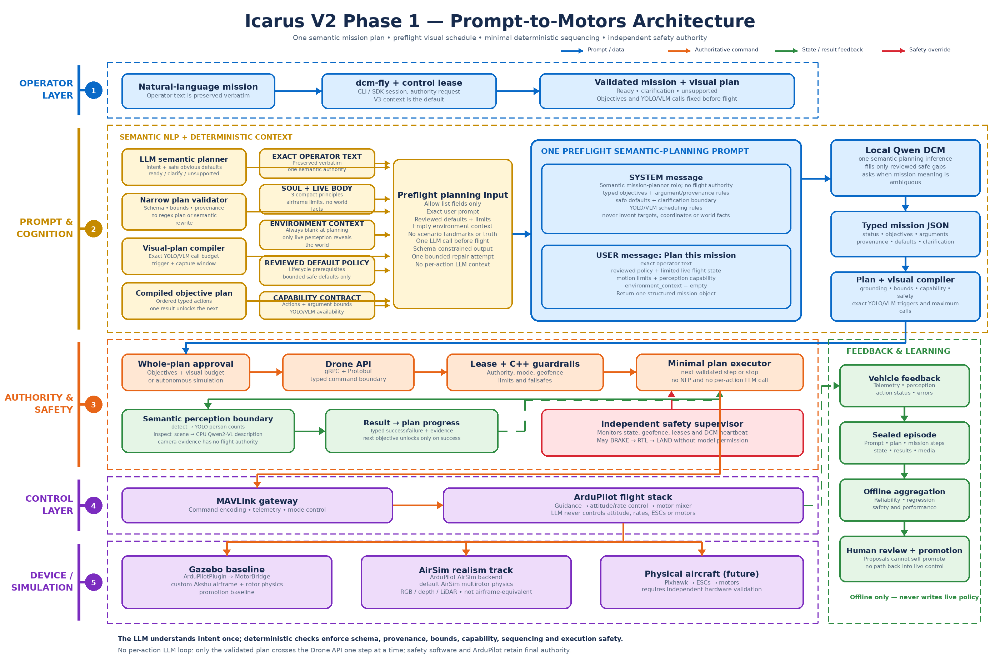

# Icarus

Icarus is a safety-bounded drone autonomy platform being developed first in
Gazebo and ArduPilot SITL, then for a Pixhawk-controlled physical aircraft. The
long-term system lets interchangeable local language models plan missions
through a typed Drone API while deterministic flight control, safety limits and
emergency behavior remain outside the model.

The repository contains a custom 10-inch quadrotor digital twin, populated
Gazebo environments, native simulated sensors, ArduPilot SITL integration,
repeatable wind/fault scenarios, and tested Drone API, safety and local
avoidance services. A simulator-only local-LLM DCM can propose typed actions in
approval or closed-loop modes; it remains unapproved for unattended or physical
flight. Compact V3 is the default DCM context and adds one compiled mission
contract, semantic live BODY facts, three reviewed operating principles,
enforced mission macros, sealed feedback artifacts and process-heartbeat
recovery without giving the model a new control path.

## Start Here

1. Read the [project goal](docs/GOAL.md).
2. Check the [master plan](docs/MASTER-PLAN.md) and
   [current status](docs/reference/PROJECT-STATUS.md), then read the
   [agent handoff](docs/NEXT-STEPS.md).
3. Understand the [software architecture](docs/architecture/SOFTWARE-ARCHITECTURE.md)
   and [simulation connections](docs/architecture/SIMULATION-CONNECTIONS.md).
   The separate experimental AirSim ArduCopter simulation track is documented in
   [AirSim Simulation](docs/architecture/AIRSIM-SIMULATION.md); it does not
   replace Gazebo as the promotion baseline. The
   [custom Icarus7 readiness report](docs/simulation/AIRSIM-ICARUS7-READINESS.md)
   separates completed source integration from the remaining Unreal build,
   wind and end-to-end runtime gates.
4. Follow [getting started](docs/guides/GETTING-STARTED.md) and the
   [simulation operator guide](docs/guides/SIMULATION-OPERATIONS.md).

The complete documentation index is [docs/README.md](docs/README.md).

## End-to-End Architecture



The operator's mission text remains intact while deterministic code compiles
reviewed references, completion evidence and one selected soft-skill macro into
a single compact `MissionContract`. The model sees three operating principles,
semantic live BODY facts, one freshness summary and the current state—not
profile hashes, filesystem paths, empty world-fact prose or repeated action
lists. The local DCM may propose one typed action; validation, authority,
safety, flight control and motor mixing remain outside the language model.
See the [V2 Phase 1 implementation](docs/architecture/V2-PHASE1-IMPLEMENTATION.md)
for the corresponding evidence and limitations.

## Simulation and Control Entry Points

```bash
# Start the world, vehicle and ArduPilot without taking control
./scripts/start-sim --profile simulation-wind --gui

# In a second terminal, choose one control client
./scripts/manual-control
./scripts/run-mission --mission takeoff_hover_land

# Legacy one-shot acceptance run
./scripts/sim --profile simulation-wind --gui

# Small AirSim compatibility track (after ./scripts/fetch-airsim-blocks)
./scripts/start-airsim-stack --binary \
  third_party/airsim/blocks-v1.8.0-linux/Blocks/LinuxNoEditor/Blocks.sh
# second terminal: ./scripts/start-autonomy-airsim

# High-detail city track (one-time CC-BY-NC asset installation first)
./scripts/fetch-airvln-environments
./scripts/start-airsim-realistic
# second terminal: ./scripts/start-autonomy-airsim
# third terminal:  ./scripts/view-airsim-camera
# fourth terminal: ./scripts/dcm-fly --runtime llama --profile edge-vision \
#   --mode autonomous --context-length 4096 --max-decisions 18 \
#   --mission "Arm, take off to 3 metres, check that building, hover over it \
#   for 3 seconds, count no. of people, then return home and land."

# Custom Icarus7 pawn (after the documented UE4.27 source build/package step)
./scripts/start-airsim-icarus7 --gui
```

List every supported or reserved profile with
`./scripts/start-sim --list-profiles`. The simulator and control clients are
separate processes. This allows keyboard, Xbox, deterministic mission and future
autonomy clients to use the same local MAVLink endpoint without rebuilding the
world. Generated worlds, logs, external source checkouts and local environments
are intentionally not versioned.

## Safety Boundary

The language model is not a flight controller. It may request bounded,
high-level actions such as takeoff, waypoint travel, return-to-home or land.
ArduPilot closes the attitude/rate loops; Icarus guardrails validate requests;
and an independent safety supervisor may reject, cancel, land or RTL. No model
gets direct motor, MAVLink, shell or unrestricted operating-system access.

## Project State

Phases 0–9 are reported complete; episode/replay, local Qwen DCM and closed-loop
simulation paths are implemented, but no language model is approved for
unattended flight. V2 Phase 1's AerialClaw-inspired candidate and AirSim
ArduCopter track are implemented and tested. V3 is now the operator-selected
default so live runs receive the compact reviewed context; `--context v2`
remains available for historical comparisons. This does not waive promotion:
the earlier feedback prompt regressed timeout/latency, and the compact revision
still needs frozen replay and paired live Gazebo evidence. It is not approved
for unattended flight. Simulation realism still requires as-built validation. See
[PROJECT-STATUS.md](docs/reference/PROJECT-STATUS.md) for exact evidence and
known limitations.
